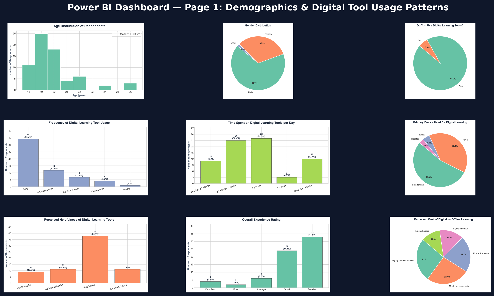
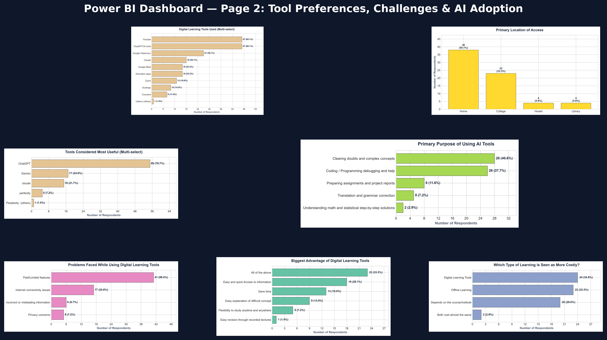

# Digital Learning Tools Survey Project

> **An End-to-End Academic Data Analytics & Business Intelligence Portfolio Project**  
> *Investigating digital learning tool adoption, study habits, platform ecosystems, and satisfaction drivers among college students.*

---

## 📌 Project Overview

This repository contains the complete research, analytical pipeline, and interactive dashboard for the field project titled **"Survey on Digital Learning Tools Usage Among College Students"**.

Conducted as part of the **B.Sc. (Data Science)** curriculum at **New Arts, Commerce and Science College, Ahmednagar (Autonomous)**, this study evaluates empirical survey responses ($N = 69$) collected via Google Forms. Using **Python (`pandas`, `numpy`, `matplotlib`, `seaborn`)** and **Microsoft Power BI**, the project uncovers tool adoption rates, daily study allocations, platform ecosystems (notably YouTube and Generative AI), economic barriers, and the key statistical drivers of student satisfaction.

---

## 🎯 Problem Statement & Research Objectives

### Problem Context
Modern college students increasingly supplement traditional classroom education with digital platforms, video tutorials, and AI-powered assistants. However, regional institutions often lack concrete empirical evidence on how widely these tools are utilized, whether students find them reliable, what workflows they support, and what financial or infrastructural obstacles prevent effective study.

### Key Research Questions
1. What digital learning tools and AI platforms do college students actively adopt?
2. How frequently and for how long do students engage with digital educational media daily?
3. Which specific platforms (YouTube, ChatGPT, Google Classroom) deliver the highest academic utility?
4. How do information accuracy perceptions correlate with overall student satisfaction?
5. What are the primary friction points (paywalls vs. connectivity) hindering digital education?

---

## 📊 Dataset Description

- **Sample Size ($N$):** 69 complete, validated college student responses.
- **Attributes:** 22 recorded survey variables across demographics, tool usage, time spent, perceived advantages, problems faced, and AI workflows.
- **Collection Window:** August 21, 2026 – September 7, 2026.
- **Data Privacy & Ethical Compliance:** In strict adherence to research ethics and data protection principles, all personally identifiable information (full names) has been de-identified to anonymous respondent codes (`Respondent_01` to `Respondent_69`).

### Key Attribute Summary

| Category | Attributes |
|:---|:---|
| **Demographics** | `age` (18–26), `gender` (Male, Female, Other), `year_of_study` (Academic stream) |
| **Tool Usage** | `uses_tools` (Yes/No), `tools_used` (Multi-select), `frequency`, `time_per_day` |
| **Academic Value** | `most_useful_tools`, `helpfulness`, `main_benefit`, `biggest_advantage` |
| **Perceptions** | `accuracy_rating` (1–5 Likert), `overall_experience` (1–5 Likert) |
| **Infrastructure & Cost** | `device` (Hardware), `access_location`, `problem_faced`, `cost_comparison`, `costlier_learning_type` |
| **AI Workflows** | `ai_purpose` (Doubts, Coding, Assignments, Language, Math) |

---

## 🛠️ Tools & Technologies Used

- **Data Analysis & Processing:** Python 3.12, Pandas, NumPy
- **Data Visualization:** Matplotlib, Seaborn
- **Business Intelligence & Reporting:** Microsoft Power BI Desktop (DAX, Interactive Slicers, Visual Formatting)
- **Document Engineering & Spreadsheets:** Microsoft Excel, Microsoft Word, PowerPoint, PyMuPDF
- **Version Control & Repository Standards:** Git, GitHub

---

## 🔄 Project Workflow Architecture

```
┌────────────────────────────────────────────────────────────────────────┐
│                        Data Analytics Pipeline                         │
└───────────────────────────────────┬────────────────────────────────────┘
                                    │
    1. Data Collection              ▼
    └── Google Forms survey administered to college student community
                                    │
    2. Data Preprocessing & Safety  ▼
    ├── Header standardization & whitespace stripping
    ├── PII de-identification (name masking)
    ├── Deduplication audit & zero-null completeness verification
    └── Multi-select pipe ("|") response decomposition
                                    │
    3. Exploratory Data Analysis    ▼
    ├── Univariate distributions & percentage frequencies
    ├── Likert ordinal mapping (1 to 5 scale)
    ├── Bivariate cross-tabulations (Frequency vs. Helpfulness)
    └── Pearson product-moment correlation analysis (r)
                                    │
    4. Business Intelligence        ▼
    ├── Power BI dimensional modeling & interactive report creation
    ├── Enterprise DAX measure formulation
    └── Custom canvas UI/UX design
                                    │
    5. Synthesis & Reporting        ▼
    ├── Comprehensive academic thesis, executive summary & presentation
    └── Production-grade GitHub repository structure
```

---

## 📈 Power BI Dashboard Preview

The interactive dashboard (`dashboard/digital_learning_tools_dashboard.pbix`) features two dedicated report pages:

### Page 1: Demographics & Digital Tool Usage Patterns
Focuses on participant age, gender, degree programs, general adoption rate (94.2%), daily study hours, hardware distribution, and perceived helpfulness.



### Page 2: Platform Preferences, Challenges & AI Adoption
Dives into multi-select tool rankings (YouTube and ChatGPT tie for #1), core AI use cases (doubt clearing and programming), obstacles faced (paywalls dominate at 59.4%), and cost comparisons.



---

## 🔍 Key Findings & Statistical Insights

### 1. Universal Digital Adoption & Habitual Use
- **94.2% Adoption:** 65 of 69 surveyed students actively rely on digital tools for their studies.
- **79.7% Near-Daily Use:** 59.4% use tools Daily; 20.3% use them 4–6 days a week.
- **Sustainable Commitment:** 62.3% dedicate between 30 minutes to 2 hours per day to digital study.

### 2. Co-Dominance of Video and Generative AI
- **YouTube (68.1%)** and **ChatGPT / AI Tools (68.1%)** tied for the #1 most utilized platforms.
- When isolating the single most useful tool, **ChatGPT led decisively with 79.7% of all votes**, followed by Google Gemini (24.6%).

### 3. The "Trust Engine" — Information Accuracy Drives Satisfaction
Pearson correlation analysis across numerical and ordinal scores revealed:
- **Trust in Accuracy $\leftrightarrow$ Overall Experience ($r = +0.686$):** Strong positive correlation. Confidence in information truthfulness is the single strongest determinant of student satisfaction.
- **Usage Frequency $\leftrightarrow$ Overall Experience ($r = +0.533$):** Moderate positive correlation. Habitual use reinforces satisfaction.
- **Age ($r = +0.193$) & Helpfulness ($r = -0.017$):** Exhibit negligible correlation, proving user satisfaction is governed by trust rather than age.

### 4. Hardware Reality & The Paywall Barrier
- **Smartphone Dominance:** 53.6% use smartphones as their primary study device (versus 39.1% on laptops).
- **Paywalls as #1 Hurdle:** 59.4% identified "Paid / limited features" as their primary challenge, outranking internet connectivity issues (24.6%) by more than 2-to-1.
- **Pragmatic AI Workflows:** 78.3% of AI use is dedicated to clearing complex theoretical concepts (40.6%) and programming/debugging code (37.7%).

---

## 💡 Strategic & Business Recommendations

1. **Institutional Software Subscriptions:** Educational institutions should negotiate campus-wide educational licenses for premier AI and developer platforms to eliminate the 59.4% paywall hurdle.
2. **Curricular AI Literacy:** Incorporate instruction on prompt engineering, hallucination auditing, and cross-verification to support the trust driver ($r = 0.69$).
3. **Mobile-First Pedagogical Interfaces:** With 53.6% of students studying on mobile phones, university portals and LMS tools must prioritize responsive mobile layouts.

---

## 📁 Repository Directory Structure

```
digital-learning-tools-survey/
├── .gitignore                              # Git exclusion rules for Python, Power BI, OS
├── LICENSE                                 # Open-source MIT license
├── README.md                               # Project documentation & portfolio showcase
├── requirements.txt                        # Pinned Python package dependencies
│
├── data/
│   ├── raw/
│   │   ├── survey_data_raw.xlsx            # De-identified raw survey matrix (Excel)
│   │   ├── survey_data_raw.csv             # De-identified raw survey matrix (CSV)
│   │   └── README.md                       # Data provenance, collection, and ethics
│   └── processed/
│       ├── survey_data_cleaned.csv         # Cleaned analysis dataset (PII removed)
│       ├── survey_data_cleaned.xlsx        # Cleaned Excel dataset with ordinal scores
│       └── survey_data_dictionary.csv      # Machine-readable data dictionary
│
├── notebooks/
│   ├── digital_learning_tools_analysis.ipynb # Clean, executable, documented Jupyter notebook
│   └── exploratory_data_analysis.py          # Standalone Python EDA pipeline script
│
├── dashboard/
│   ├── digital_learning_tools_dashboard.pbix  # Interactive Power BI report file
│   ├── dashboard_documentation.md             # In-depth visual catalog & DAX guide
│   └── screenshots/
│       ├── dashboard_page1_overview.png       # Page 1 preview
│       ├── dashboard_page2_deepdive.png       # Page 2 preview
│       ├── pbi_canvas_background_page1.png    # Canvas background template 1
│       ├── pbi_canvas_background_page2.png    # Canvas background template 2
│       └── key_visuals/                      # 21 High-res individual visual charts
│
├── reports/
│   ├── project_report.md                      # Markdown format of project report
│   ├── project_report.docx                    # Original analysis report
│   ├── full_project_dissertation.docx         # Complete academic thesis dissertation
│   └── executive_summary.md                   # 2-Page executive summary for stakeholders
│
├── presentation/
│   ├── digital_learning_tools_presentation.pptx # 15-Slide defense presentation
│   └── presentation_overview.md                 # Slide walkthrough & viva defense notes
│
└── docs/
    ├── problem_statement.md                   # Problem context & research questions
    ├── project_methodology.md                 # Research design, sampling & analytical toolchain
    ├── data_dictionary.md                     # Tabular attribute data dictionary
    ├── survey_questionnaire.md                # Full 20-question survey instrument
    ├── findings_and_insights.md               # Empirical findings & correlation analysis
    └── project_synopsis.md                    # Official academic synopsis & viva guide
```

---

## 🚀 How to Run & Reproduce the Analysis

### 1. Clone the Repository
```bash
git clone https://github.com/your-username/digital-learning-tools-survey.git
cd digital-learning-tools-survey
```

### 2. Set Up Python Environment
```bash
python -m venv venv
# On Windows:
venv\Scripts\activate
# On macOS/Linux:
source venv/bin/activate

pip install -r requirements.txt
```

### 3. Run the Automated Python Pipeline
```bash
python notebooks/exploratory_data_analysis.py
```

### 4. Launch the Jupyter Notebook
```bash
jupyter notebook notebooks/digital_learning_tools_analysis.ipynb
```

### 5. Open the Power BI Dashboard
1. Ensure **Microsoft Power BI Desktop** is installed.
2. Double-click `dashboard/digital_learning_tools_dashboard.pbix`.
3. If prompted to refresh data, verify data source points to `data/processed/survey_data_cleaned.xlsx`.

---

## 🔮 Future Enhancements

- **Longitudinal Tracking:** Evaluate GPA and academic performance shifts across multiple semesters after AI adoption.
- **Multi-Disciplinary Expansion:** Expand the sampling frame beyond computer science to arts, commerce, and medical disciplines.
- **Power BI Unpivoted Modeling:** Unpivot pipe-delimited multi-select fields in Power Query to enable real-time dynamic slicer cross-filtering across individual tools.

---

## 👤 Author & Academic Credits

- **Author:** **Waghmare Ganesh Jalindar**  
  *B.Sc. (Data Science) — CASAS*  
  New Arts, Commerce and Science College, Ahmednagar (Ahilyanagar), Maharashtra  
- **Academic Mentor:** **Prof. Arjana Shaikh**, Department of Data Science  
- **Department Head:** **Prof. Arun D. Gangarde**, Department of Data Science  
